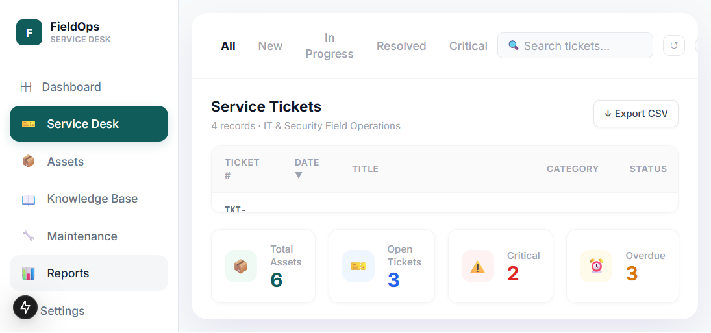
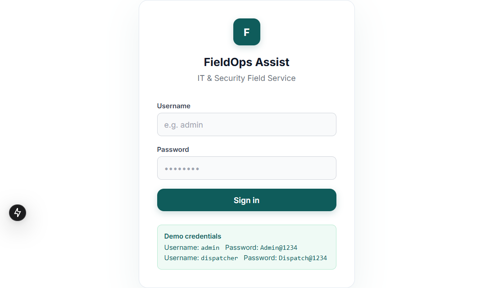

# FieldOps Assist

FieldOps Assist is an IT and security field-service platform for managing service tickets, assets, customers, sites, technicians, maintenance, contracts, knowledge, reports, and AI-assisted troubleshooting.

The project includes:

- A FastAPI backend with a SQLite database
- A Next.js frontend with a responsive operations dashboard
- JWT authentication and role-aware API access
- Demo seed data for local development
- Optional OpenAI, Anthropic, and retrieval-augmented troubleshooting services

## Screenshots

### Operations dashboard



### Login



## Stack

| Layer | Technologies |
| --- | --- |
| Backend | Python, FastAPI, SQLAlchemy, Pydantic |
| Frontend | Next.js, React, TypeScript, Tailwind CSS |
| Data | SQLite |
| AI/RAG | OpenAI, Anthropic, sentence-transformers, FAISS |
| Testing | pytest, pytest-asyncio, TypeScript, ESLint |

## Project structure

```text
backend/
  app/
    api/routes/       FastAPI route modules
    core/             Configuration, dependencies, security
    db/               SQLAlchemy models, sessions, demo seed data
    schemas/          Pydantic request and response schemas
    services/         Document parsing, LLM, and RAG services
  tests/
frontend/
  src/
    app/              Next.js pages and global styles
    components/       Shared UI components
    lib/              API client and authentication context
    types/            Shared TypeScript types
docs/                 Application screenshots
```

## Requirements

- Python 3.10+
- Node.js 18.18+
- npm

## Local setup

### 1. Configure the backend

From the project root:

Create a local `.env` file in the project root using the configuration names listed in the [Configuration](#configuration) section. Keep this file local and update `SECRET_KEY` before using the application outside local development.

Create and activate a virtual environment:

```powershell
cd backend
python -m venv .venv
.\.venv\Scripts\Activate.ps1
pip install -r requirements.txt
```

### 2. Start the backend

```powershell
cd backend
.\.venv\Scripts\python.exe -m uvicorn main:app --reload --host 127.0.0.1 --port 8000
```

The API is available at [http://localhost:8000](http://localhost:8000). Interactive API documentation is available at [http://localhost:8000/api/docs](http://localhost:8000/api/docs).

### 3. Start the frontend

In a second terminal:

```powershell
cd frontend
npm install
npm run dev
```

Open [http://localhost:3000](http://localhost:3000).

## Demo credentials

The development seed creates demo users:

| Username | Password |
| --- | --- |
| `admin` | `Admin@1234` |
| `dispatcher` | `Dispatch@1234` |

Do not use these credentials in a production deployment.

## Useful commands

### Backend

```powershell
cd backend
.\.venv\Scripts\python.exe -m pytest -q
```

### Frontend

```powershell
cd frontend
npm run lint
npm run type-check
npm run build
```

## Configuration

Copy `.env.example` to `.env` and configure:

- `DATABASE_URL` for the database connection
- `SECRET_KEY` for JWT signing
- `CORS_ORIGINS` for allowed frontend origins
- `NEXT_PUBLIC_API_URL` for the frontend API base URL
- `LLM_PROVIDER` as `none`, `openai`, or `anthropic`
- `OPENAI_API_KEY` or `ANTHROPIC_API_KEY` when using an LLM provider
- `SEED_DEMO_DATA` to enable or disable demo records

The default `LLM_PROVIDER=none` mode keeps the application usable without external AI credentials.

## API areas

The backend exposes API routes for:

- Authentication and users
- Customers and sites
- Assets and service tickets
- Technicians, maintenance, and contracts
- Knowledge base and AI troubleshooting
- Reports, dashboard metrics, audit logs, and health checks

## Security notes

- Keep `.env`, database files, uploaded documents, and vector stores out of version control.
- Replace the development secret key before deployment.
- Configure CORS to allow only trusted frontend origins.
- Use HTTPS and secure secret management in production.

## License

This project is a portfolio demonstration and uses fictional operational data.
